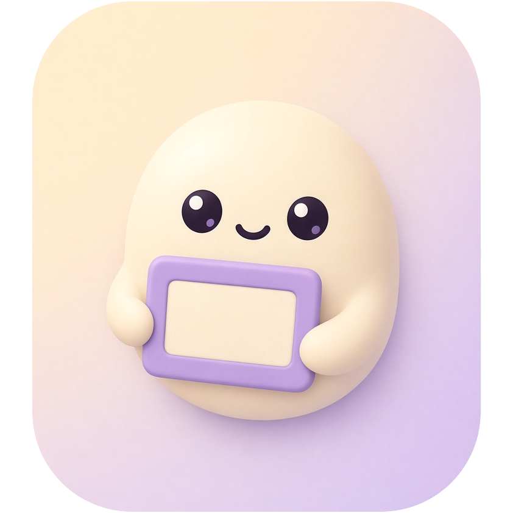

<p align="center">
  
</p>

# clipt

A lightweight screenshot tool for Wayland and X11, in the spirit of Flameshot: freeze
the screen, drag a region, annotate it, copy or save. One small Rust binary, no
Qt/GTK, CPU-rendered with tiny-skia.


## Desktop support

| Desktop | Capture | Overlay | Tested in CI |
|---|---|---|---|
| KDE Plasma | KWin ScreenShot2 | layer-shell | by hand (no headless KWin) |
| GNOME | xdg-desktop-portal | fullscreen window | GNOME Shell 51, 1 and 2 monitors |
| Sway | ext-image-copy-capture / wlr-screencopy | layer-shell | Sway 1.12, 4 layouts incl. mixed DPI, rotation |
| niri | wlr-screencopy | layer-shell | yes |
| labwc | ext-image-copy-capture / wlr-screencopy | layer-shell | yes |
| Hyprland, river, Wayfire, COSMIC | ext-image-copy-capture / wlr-screencopy | layer-shell | same protocols as above; no headless CI run |
| X11: Xfce, Cinnamon, MATE, LXQt, i3, Openbox, … | GetImage (RandR/Xinerama monitors) | override-redirect windows, MIT-SHM | Xvfb + headless Xorg under Openbox, 1 and 3 monitors |

The capture backend is picked automatically (override with `-b ext|wlr|kwin|portal|x11`
or `backend =` in the config). On X11 the clipboard supports INCR, so large
PNGs paste correctly into any application, and compositor users can exclude
the overlay by its `WM_CLASS`, `clipt`.

Builds and packages: x86_64 and aarch64 release tarballs, `.deb` and `.rpm`,
a Nix flake and crates.io; it also compiles for musl, armv7, riscv64 and
FreeBSD. Arch packages (`clipt`, `clipt-bin`) aren't on the AUR yet; until
they are, build one from `packaging/aur/` with `makepkg -si`.

### Multiple monitors

There is no "pick a monitor" step: every monitor gets its own overlay at the
same time, each drawn at that monitor's native resolution, and you can drag a
selection on any of them, or across two. Mixed resolutions, fractional scaling
(1.25×, 1.5×), offset layouts and rotated portrait monitors are all covered by
the end-to-end tests, and saved images keep the native pixel size of the
monitor they came from.

## Usage

```
clipt               # interactive (same as `clipt gui`)
clipt full -c       # whole desktop to the clipboard
clipt screen DP-1   # one output, saved to the save dir
clipt full -g "$(slurp)" -o -   # slurp region to stdout
clipt list          # outputs and available backends
clipt tray          # tray icon: click = region, right-click = menu
clipt update        # update to the latest release (--check: just check)
clipt record screen # record the first output to ~/Videos/Screencasts
clipt record --stop # ...and stop it (or Ctrl-C)
```

**Recording (early):** `clipt record screen [NAME]` or `clipt record -g
"X,Y WxH"` records to MP4 until `clipt record --stop`, Ctrl-C or
`max_duration` (1 h). It needs `ffmpeg` and uses the GPU encoder when there
is one (VA-API on AMD and Intel, NVENC on NVIDIA), libx264 otherwise. For now
it works on wlroots-family compositors (Sway, Hyprland, niri, labwc, river,
COSMIC); window recording, the selection overlay, KDE, GNOME and X11 are
planned (see [docs/recording-plan.md](docs/recording-plan.md)).

Before you select anything, clipt highlights what a click would take: the
window under the pointer (KDE, Sway, Hyprland and X11), or the whole screen
over bare desktop. **Tab** switches between the window and its screen. On
GNOME, which doesn't let other apps see window positions, the highlight is
always the screen.

Editor: drag to select (click = the highlighted window or screen), drag handles to resize, drag
inside to move. Tools: **V** select, **R** rectangle, **E** ellipse, **A**
arrow, **L** line, **P** pen, **M** highlighter, **T** text, **X** pixelate,
**N** numbered counter. **1–8** colour, scroll or **[ ]** stroke width, Shift
for squares and 45° lines. **Enter**/**Ctrl+C**/double-click copies, **Ctrl+S**
saves, **Ctrl+Z**/**Ctrl+Shift+Z** undo/redo, **Esc** cancels, right-click
backs out a step.

`clipt tray` puts an icon in the system tray (StatusNotifierItem: KDE, waybar,
GNOME with the AppIndicator extension, Xfce, …). Left-click captures a region,
middle-click copies the whole desktop, and the right-click menu adds a 3-second
delay, the screenshots folder and Quit. Each capture runs as a fresh `clipt`
process, so the tray itself stays idle.

**Updates:** `clipt update` (or *Check for updates…* in the tray menu)
asks GitHub for the latest release. When clipt was installed with
`install.sh`, it downloads the tarball for your architecture, checks its
SHA-256 and replaces itself; packaged installs are pointed at their package
manager. It only goes online when you ask, or daily from the tray if you set
`check_updates = true`. Needs `curl`.

After copying, clipt forks into the background to serve the clipboard until
something else is copied (Wayland clipboards are owned by a live client).

## Config

`~/.config/clipt/config.toml`, every key optional:

```toml
save_dir = "~/Pictures/Screenshots"
filename = "Screenshot_%Y-%m-%d_%H-%M-%S"   # strftime
color = 1            # 1-8: red orange yellow green blue purple white black
width = 4
copy_on_save = true
notify = true
backend = "auto"     # ext, wlr, kwin, portal
cursor = false
# font = "/usr/share/fonts/TTF/Inter-Regular.ttf"
check_updates = false   # `clipt tray` checks GitHub daily for a new release
```

## Performance

Measured on a 4K KDE Plasma 6.8 desktop:

|                          | clipt  | Spectacle 6.8 | Flameshot 14 |
|--------------------------|--------|---------------|--------------|
| Full-screen capture to PNG | ~100 ms | 388 ms      | 593 ms       |
| Region overlay memory    | 71 MB  | 337 MB        | 126 MB       |
| CPU to open the overlay  | 50 ms  | 570 ms        | 140 ms       |

Redraws are damage-tracked: moving the pointer or drawing touches only the
changed pixels (0.5-5 ms per frame at 4K).

## Install

From a release tarball or a checkout:

```
./install.sh        # builds if needed; ~/.local/bin/clipt + desktop entry
./install.sh --tray # same, plus start `clipt tray` at login
```

On KDE the desktop entry carries `X-KDE-DBUS-Restricted-Interfaces` so KWin
lets clipt capture silently. Bind `clipt` to Print in System Settings →
Shortcuts.

**GNOME:** captures go through the screenshot portal, which needs the desktop
entry (clipt registers its app ID from it, and GLib ignores entries whose
`Exec` doesn't resolve) plus a one-time permission. If you aren't prompted,
grant it directly:

```
gdbus call --session --dest org.freedesktop.impl.portal.PermissionStore \
  --object-path /org/freedesktop/impl/portal/PermissionStore \
  --method org.freedesktop.impl.portal.PermissionStore.SetPermission \
  screenshot true screenshot clipt "['yes']"
```

## Development

See [CONTRIBUTING.md](CONTRIBUTING.md) for the checks CI runs, the
containerised Sway/GNOME end-to-end suites and the benchmarks.

## Licence

Dual-licensed under [MIT](LICENSE-MIT) or [Apache-2.0](LICENSE-APACHE), at
your option.
