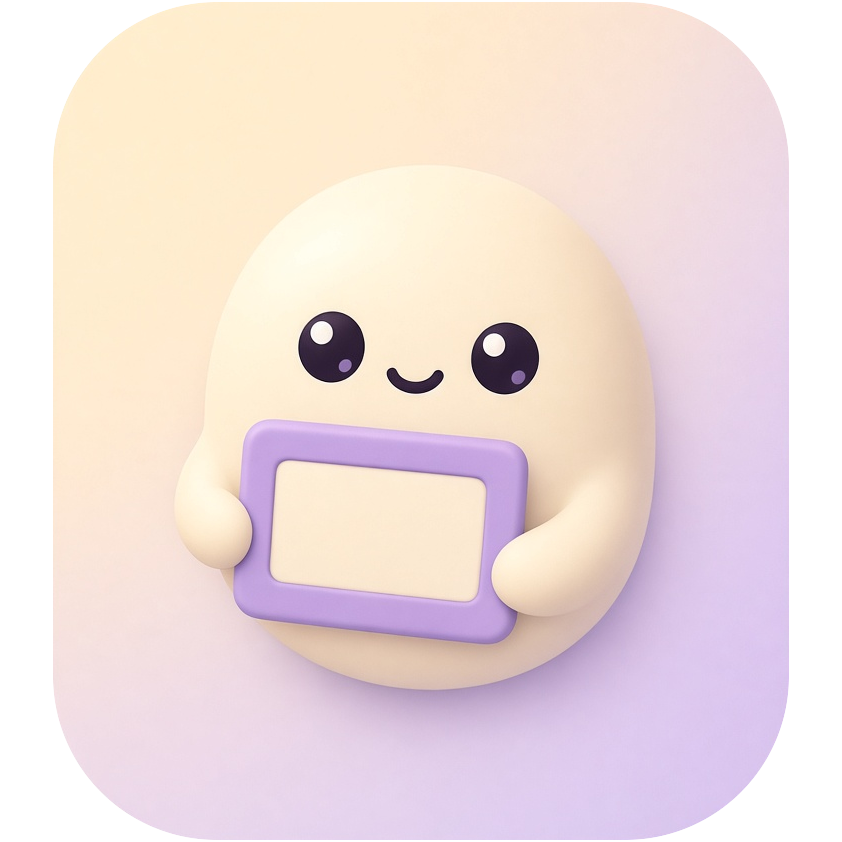

<p align="center">
  
</p>

# clipt

A lightweight screenshot tool for Wayland and X11, in the spirit of Flameshot: freeze
the screen, drag a region, annotate it, copy or save. It also records the screen,
a region or a window to MP4 or GIF. One small Rust binary, no Qt/GTK,
CPU-rendered with tiny-skia.


## Quick start

- `clipt` — select a region and annotate it
- `clipt full -c` — whole desktop to the clipboard
- `clipt screen` — one output, saved to the save dir

## Desktop support

| Desktop | Capture | Overlay | Tested in CI |
|---|---|---|---|
| KDE Plasma | KWin ScreenShot2 | layer-shell | by hand (no headless KWin) |
| GNOME | Mutter ScreenCast (screenshot portal as fallback) | fullscreen window | GNOME Shell 51, 1 and 2 monitors |
| Sway | ext-image-copy-capture / wlr-screencopy | layer-shell | Sway 1.12, 4 layouts incl. mixed DPI, rotation |
| niri | wlr-screencopy | layer-shell | yes |
| labwc | ext-image-copy-capture / wlr-screencopy | layer-shell | yes |
| Hyprland, river, Wayfire, COSMIC | ext-image-copy-capture / wlr-screencopy | layer-shell | same protocols as above; no headless CI run |
| X11: Xfce, Cinnamon, MATE, LXQt, i3, Openbox, … | GetImage (RandR/Xinerama monitors) | override-redirect windows, MIT-SHM | Xvfb + headless Xorg under Openbox, 1 and 3 monitors |
| macOS 12+ (preview: screenshots only) | Core Graphics | borderless windows | builds and unit tests; see [macOS](#macos-preview) |
| Windows 10 and 11 (early: screenshots only) | GDI | topmost windows | builds, unit tests and a capture; see [Windows](#windows-early) |

The capture backend is picked automatically (override with `-b ext|wlr|kwin|mutter|portal|x11`
or `backend =` in the config). On X11 the clipboard supports INCR, so large
PNGs paste correctly into any application, and compositor users can exclude
the overlay by its `WM_CLASS`, `clipt`.

Builds and packages: x86_64 and aarch64 release tarballs, `.deb` and `.rpm`,
a Nix flake and crates.io; it also compiles for musl, armv7, riscv64 and
FreeBSD. Arch packages (`clipt`, `clipt-bin`) aren't on the AUR yet; until
they are, build one from `packaging/aur/` with `makepkg -si`.

### Multiple monitors

There is no "pick a monitor" step: every monitor gets its own overlay at the
same time, each drawn at that monitor's native resolution, and you can drag a
selection on any of them, or across two. Mixed resolutions, fractional scaling
(1.25×, 1.5×), offset layouts and rotated portrait monitors are all covered by
the end-to-end tests, and saved images keep the native pixel size of the
monitor they came from.

## Usage

```
clipt               # interactive (same as `clipt gui`)
clipt full -c       # whole desktop to the clipboard
clipt screen DP-1   # one output, saved to the save dir
clipt full -g "$(slurp)" -o -   # slurp region to stdout
clipt list          # outputs and available backends
clipt tray          # tray icon: click = region, right-click = menu
clipt update        # update to the latest release (--check: just check)
clipt config        # list the settings; clipt config KEY VALUE sets one
clipt record        # pick an area to record, Enter starts
clipt record --stop # ...and stop it (or Ctrl-C, or click the tray icon)
clipt record --audio # with the sound the computer is playing
clipt record --audio=system:70,mic:120  # and the microphone, mixed
```

**Recording (early):** `clipt record` opens the selection overlay without the
annotation tools: drag an area (or click a window or screen) and press
**Enter**. A red frame marks the area while it records, outside it so it's
not in the video. A clicked window is followed as it moves, and when it's
resized the video keeps its size and zooms smoothly to fit (never enlarging
past 1:1). Compositors that can capture single windows (Sway 1.11+, Hyprland
0.50+, COSMIC) record just the window, even when something covers it; on Sway
and Hyprland without that, clipt follows it by position instead. `clipt record screen [NAME]` and `clipt record -g "X,Y
WxH"` skip the overlay. `--pause`, `--resume` and `--toggle-pause` pause
without a gap in the video (the frame turns amber); `--stop`, Ctrl-C or
`max_duration` (1 h) end it. The tray menu has the same controls, and its icon
shows a red dot while recording. Files go to `~/Videos/Screencasts` as MP4,
or as a GIF with `--gif` (or `record_format = "gif"`). `--audio` (or
`record_audio = "system"`) records the sound the computer is playing too,
through a PulseAudio or pipewire-pulse server. `--audio=mic`, `both`, or a
list of sources with volumes (`system:70,mic:120`, device names from `clipt
list sound`) mixes several into one track; `--separate-audio` also keeps
each as its own track, to rebalance later in an editor. `--audio-balance=duck`
(or `record_audio_balance = "duck"`) cleans up the microphone's sound in the
mix and dips the other sources while you speak; `smart` also says at the
stop how clearly your voice came through, and if the other sound covered
it, mixes again with that sound quieter. With speakers rather than
headphones the microphone hears the system sound too (`smart` notices).
It needs `ffmpeg` and uses the GPU encoder when there is one (VA-API on AMD
and Intel, NVENC on NVIDIA), libx264 otherwise. It works on wlroots-family
compositors (Sway, Hyprland, niri, labwc, river, COSMIC) directly, and on KDE
Plasma and GNOME through PipeWire (KWin's and Mutter's own screencasts, so
no permission dialog); libpipewire is loaded only when recording there.
On X11 it reads frames over MIT-SHM, only when the screen changes (DAMAGE).
Elsewhere it falls back to the ScreenCast portal (`-b portal`), which asks
once which screen to share. `clipt record window APP` records the topmost
window with that app id. The Flatpak records too, with its own ffmpeg (see
[docs/recording-plan.md](docs/recording-plan.md)).

Before you select anything, clipt highlights what a click would take: the
window under the pointer (KDE, Sway, Hyprland and X11), or the whole screen
over bare desktop. **Tab** switches between the window and its screen.
GNOME doesn't let other apps see window positions, so there the highlight
is always the screen, unless you install clipt's small GNOME Shell
extension, which tells clipt alone where windows are (and draws the frame
around a recording, which GNOME otherwise has no way to show):

```
clipt gnome-extension    # install and enable it; log out and back in once
```

Editor: drag to select (click = the highlighted window or screen), then
annotate with the toolbar, and copy with **Enter** or save with **Ctrl+S**.
Hover over a toolbar button for its key, or press **?** for the full list.
On macOS, Cmd stands in for Ctrl and Option for Alt.

<details>
<summary>Every shortcut</summary>

<!-- shortcuts: generated from src/editor/keys.rs -->
| Key | |
|---|---|
| **Select** | |
| <kbd>Drag</kbd> | Select an area |
| <kbd>Click</kbd> | The highlighted window or screen |
| <kbd>Tab</kbd> | Window or its whole screen |
| <kbd>Ctrl+A</kbd> | The whole screen |
| <kbd>Shift+drag</kbd> | A square |
| <kbd>Arrows</kbd> | Move it a pixel |
| <kbd>Alt+Arrows</kbd> | Move it 10 pixels |
| <kbd>Shift+Arrows</kbd> | Resize it |
| **Tools** | |
| <kbd>V</kbd> | Select and move |
| <kbd>R</kbd> | Rectangle |
| <kbd>E</kbd> | Ellipse |
| <kbd>A</kbd> | Arrow |
| <kbd>L</kbd> | Line |
| <kbd>P</kbd> | Pen |
| <kbd>M</kbd> | Highlighter |
| <kbd>T</kbd> | Text |
| <kbd>X</kbd> | Pixelate |
| <kbd>N</kbd> | Counter |
| <kbd>Shift</kbd> | Square, circle or 45° line |
| **Style** | |
| <kbd>1–8</kbd> | Colour |
| <kbd>Right-click</kbd> | On a colour: change it |
| <kbd>[</kbd> | Thinner |
| <kbd>]</kbd> | Thicker |
| <kbd>Scroll</kbd> | Thinner or thicker |
| **Edit** | |
| <kbd>V, click</kbd> | Pick a shape to move or restyle |
| <kbd>Delete</kbd> | Remove the picked shape |
| <kbd>V, double-click</kbd> | Edit text |
| <kbd>Shift+Enter</kbd> | New line in text |
| <kbd>Ctrl+Z</kbd> | Undo |
| <kbd>Ctrl+Shift+Z</kbd> | Redo |
| <kbd>Right-click</kbd> | Back out a step |
| **Finish** | |
| <kbd>Enter</kbd> | Copy |
| <kbd>Double-click</kbd> | Copy |
| <kbd>Ctrl+C</kbd> | Copy |
| <kbd>Ctrl+S</kbd> | Save |
| <kbd>Ctrl+R</kbd> | Record a video instead |
| <kbd>Esc</kbd> | Cancel |
| <kbd>?</kbd> | Show or hide the shortcuts |
| **Record** | |
| <kbd>S</kbd> | Computer sound on or off |
| <kbd>M</kbd> | Microphone on or off |
| <kbd>G</kbd> | GIF or video |
| <kbd>Enter</kbd> | Start recording |
| <kbd>Right-click</kbd> | Select again |
| <kbd>Ctrl+R</kbd> | A screenshot instead |
| <kbd>Esc</kbd> | Cancel |
| <kbd>?</kbd> | Show or hide the shortcuts |
<!-- /shortcuts -->

</details>

To record a video instead, click **Video** at the bottom of the screen (or
press **Ctrl+R**), select, toggle sound with **S** and the microphone with
**M**, choose a GIF with **G** (remembered for next time), and press
**Enter**; stop it from the tray or with `clipt record --stop`.

`clipt tray` puts an icon in the system tray (StatusNotifierItem: KDE, waybar,
GNOME with the AppIndicator extension, Xfce, …). Left-click captures a region,
middle-click copies the whole desktop, and the right-click menu adds a 3-second
delay, recording, the folders, ticks for *Record as GIF*, *Copy when saving*
and *Notifications*, *Settings…* (opens the config file) and Quit. Each
capture runs as a fresh `clipt` process, so the tray itself stays idle.

**Updates:** `clipt update` (or *Check for updates…* in the tray menu)
asks GitHub for the latest release. When clipt was installed with
`install.sh`, it downloads the tarball for your architecture, checks its
SHA-256 and replaces itself; packaged installs are pointed at their package
manager. It only goes online when you ask, or daily from the tray if you set
`check_updates = true`. Needs `curl`.

After copying, clipt forks into the background to serve the clipboard until
something else is copied (Wayland clipboards are owned by a live client).

## Config

`~/.config/clipt/config.toml`, every key optional. `clipt config` lists
them with their values, and `clipt config record_format gif` sets one
without touching the rest of the file:

```toml
save_dir = "~/Pictures/Screenshots"
filename = "Screenshot_%Y-%m-%d_%H-%M-%S"   # strftime
color = 1            # 1-8: red orange yellow green blue purple white black
# palette = ["#ef4444", "#f97316", "#eab308", "#22c55e", "#3b82f6", "#a855f7", "#ffffff", "#111111"]
width = 4
copy_on_save = true
notify = true
backend = "auto"     # ext, wlr, kwin, mutter, portal
cursor = false
# font = "/usr/share/fonts/TTF/Inter-Regular.ttf"
check_updates = false   # `clipt tray` checks GitHub daily for a new release
```

## Performance

Measured on a 4K KDE Plasma 6.8 desktop:

|                          | clipt  | Spectacle 6.8 | Flameshot 14 |
|--------------------------|--------|---------------|--------------|
| Full-screen capture to PNG | ~100 ms | 388 ms      | 593 ms       |
| Region overlay memory    | 71 MB  | 337 MB        | 126 MB       |
| CPU to open the overlay  | 50 ms  | 570 ms        | 140 ms       |

Redraws are damage-tracked: moving the pointer or drawing touches only the
changed pixels (0.5-5 ms per frame at 4K).

## Install

From a release tarball or a checkout:

```
./install.sh        # builds if needed; ~/.local/bin/clipt + desktop entry
./install.sh --tray # same, plus start `clipt tray` at login
```

On KDE the desktop entry carries `X-KDE-DBUS-Restricted-Interfaces` so KWin
lets clipt capture silently. Bind `clipt` to Print in System Settings →
Shortcuts.

**GNOME:** captures come from Mutter's ScreenCast, one frame per monitor at
its own resolution, with no dialog and no flash. If a monitor sends nothing
within half a second, clipt takes that one from the screenshot portal
instead. The portal needs the desktop entry (clipt registers its app ID
from it, and GLib ignores entries whose `Exec` doesn't resolve) plus a
one-time permission. If you aren't prompted, grant it directly:

```
gdbus call --session --dest org.freedesktop.impl.portal.PermissionStore \
  --object-path /org/freedesktop/impl/portal/PermissionStore \
  --method org.freedesktop.impl.portal.PermissionStore.SetPermission \
  screenshot true screenshot clipt "['yes']"
```

### macOS (preview)

Screenshots and the menu bar icon work on macOS (recording doesn't yet),
and have been tried on one Mac so far. Each release has `clipt.app`
(`clipt-vX.Y.Z-macos-app.zip`; drag it to Applications, and macOS asks once
to let clipt record the screen). Opening it puts clipt in the menu bar,
with **⌘⇧2** to capture a region from anywhere (`hotkey` in the config;
`hotkey_full` adds one for the whole desktop). There's also a universal
binary for the command line,
`clipt-vX.Y.Z-universal-macos.tar.gz`, both signed with a Developer ID and
notarised by Apple. Put the binary somewhere on your `PATH`, and
`clipt update` keeps it current:

```
tar xzf clipt-*-universal-macos.tar.gz
./clipt-*-universal-macos/clipt full -o test.png   # macOS asks to allow Screen Recording once
```

Builds of `main` come from the `macos` CI job (the `clipt-macos` artifact).

⌘ takes the place of Ctrl in the editor (⌘C copies, ⌘S saves, ⌘Z undoes).
[docs/macos-plan.md](docs/macos-plan.md) has what's done, what's next, and
a checklist for testers.

### Windows (early)

Screenshots work on Windows: `clipt` (the editor), `clipt full` and
`clipt screen`, with copy and save as on Linux, and `clipt tray` puts an
icon in the notification area with **Print Screen** to capture a region.
`clipt record` records a region, a monitor or a window, with sound, as on
Linux, into `Videos\Captures`, and the tray has the same recording
controls as on Linux (its icon gets a red dot while recording); it needs ffmpeg (`winget install
Gyan.FFmpeg`, or `ffmpeg.exe` beside `clipt.exe`). It hasn't been tried on
a real PC. Releases have `clipt-vX-x86_64-windows.zip` (unsigned, so
Windows asks before the first run); builds of `main` come from the `windows` CI job (the
`clipt-windows` artifact). This repository is also a [Scoop](https://scoop.sh)
bucket:

```
scoop bucket add clipt https://github.com/jasondyck/clipt   # once
scoop install clipt/clipt                                   # later: scoop update clipt
```

```
clipt.exe                    # select, annotate, copy (Enter) or save (Ctrl+S)
clipt.exe full -c            # the whole desktop to the clipboard
clipt.exe record             # pick an area or window, Enter records
clipt.exe record --stop      # stop it (or Ctrl+C where it runs)
clipt.exe tray               # the tray icon; its menu has Start with Windows
clipt.exe update             # update to the latest release (--check: just check)
```

Windows 11 gives Print Screen to the Snipping Tool. To have it open clipt,
turn off *Settings > Accessibility > Keyboard > Use the Print screen key to
open screen capture*, or pick another key (`clipt config hotkey
ctrl+shift+s`).

Screenshots go to Pictures\Screenshots and the config is
`%APPDATA%\clipt\config.toml`. [docs/windows-plan.md](docs/windows-plan.md)
has what's done and what's next.

### Shell completions

The packages, `install.sh` and the release tarballs install these, along
with the man page (`man clipt`). From a checkout, without installing, the
scripts in `data/completions/` work as they are:

```
data/completions/clipt.bash   # bash: source it, or copy to /usr/share/bash-completion/completions/clipt
data/completions/_clipt       # zsh: copy to a directory in $fpath, then run compinit
data/completions/clipt.fish   # fish: copy to ~/.config/fish/completions/clipt.fish
```

## Development

See [CONTRIBUTING.md](CONTRIBUTING.md) for the checks CI runs, the
containerised Sway/GNOME end-to-end suites and the benchmarks.

## Licence

Dual-licensed under [MIT](LICENSE-MIT) or [Apache-2.0](LICENSE-APACHE), at
your option.
